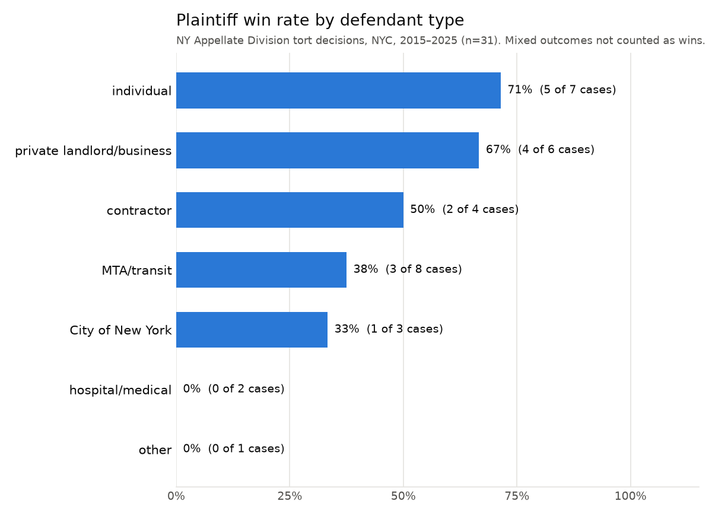

# Who wins NYC tort appeals?

An LLM-assisted annotation of New York Appellate Division tort decisions involving
New York City, 2015–2025.



## Question

When a personal-injury (tort) case from New York City reaches the Appellate Division,
does the plaintiff's chance of winning depend on **who the defendant is**: the City,
NYCHA, the MTA, a private business, a contractor, a hospital, or an individual?

## Data source

Opinions come from [CourtListener](https://www.courtlistener.com/) (Free Law Project),
restricted to the New York Appellate Division (`court=nyappdiv`), 2015–2025.
Cases were picked by keyword searches in five areas: premises/slip-and-fall,
car and pedestrian accidents, construction accidents under Labor Law §§ 240/241,
negligence claims against the City or NYCHA, and medical malpractice. Searches
were limited to NYC with borough and county names (Brooklyn, Kings County, etc.).

- `download_cases.py` runs these searches through the CourtListener v4 search API
  and saves each opinion's full text.
- The API rate-limited our token partway through, so most of the final set was
  copied by hand from the same courtlistener.com searches. `build_index.py` indexes
  those files.

The final dataset has **31 unique opinions** (`cases_index.csv`). The `cases/` folder
itself is not committed; rerun the scripts to rebuild it.

## Method

1. **Annotation.** `annotate.py` sends each opinion, with the instructions in
   `prompt.txt`, to the OpenRouter chat completions API using the `openrouter/free`
   model router. The model returns JSON with `case_name`, `year`, `tort_type`,
   `defendant_type`, `procedural_stage`, `winner`, and a one-sentence `reason`.
   - `winner` means who prevailed **in this appellate decision**. An affirmance of a
     ruling for the defendant counts as a defendant win.
   - Requests are spaced 5 seconds apart, each failure is retried once, and finished
     cases are skipped on rerun.
   - Results are saved to `results.csv`. The `model` column records which free model
     answered, because `openrouter/free` routes each request to a different model.
2. **Validation.** I checked every `winner` label by hand against the opinion's
   decretal paragraph (the "ORDERED that…" or "Order … affirmed/reversed" line).
   See *Limitations* below.
3. **Visualization.** `make_chart.py` plots the share of decisions won by the
   plaintiff for each defendant type and saves `chart.png`. "Mixed" outcomes count
   as not a plaintiff win.

## How to run

```bash
python3 -m venv .venv
source .venv/bin/activate
pip install requests matplotlib

export COURTLISTENER_TOKEN=your_token_here
export OPENROUTER_API_KEY=your_key_here

python download_cases.py      # search CourtListener and save opinions to cases/
python build_index.py         # (optional) rebuild cases_index.csv from whatever is in cases/
python annotate.py --limit 5  # test on 5 cases
python annotate.py            # annotate the rest (resumes where it left off)
python make_chart.py          # write chart.png
```

API keys are read only from environment variables and are never written to files.
`.gitignore` excludes `cases/`, `.env`, and key/token files.

## Main findings

Across all 31 decisions, plaintiffs won 15 (48%), defendants won 13 (42%), and
3 were mixed.

- **Public defendants did worse for plaintiffs than private ones.** Plaintiffs won
  4 of 11 appeals (36%) against the City of New York or MTA/transit, compared with
  11 of 17 (65%) against individuals, private businesses, and contractors.
- **Individuals and private businesses had the highest plaintiff win rates:**
  individuals 5 of 7 (71%), private landlords/businesses 4 of 6 (67%). Most
  individual-defendant cases are rear-end or pedestrian car accidents, where New
  York law presumes the rear driver was negligent.
- **Transit and City defendants won on specific defenses.** Plaintiffs won
  3 of 8 MTA/transit cases (38%) and 1 of 3 City cases (33%). Three of the transit
  defense wins involved the **emergency doctrine**: the bus stopped suddenly to
  avoid a pedestrian or car. The City wins turned on proof: no notice of the
  roadway defect, or no evidence the City was responsible for it.
- **By tort type,** plaintiffs did better in car/pedestrian cases (7 of 12) than in
  slip-and-fall cases (5 of 14), which defendants often win on summary judgment.
- Both hospital/medical cases were defense wins, but two cases is too few to
  draw any conclusion.

## Limitations

- **Small, non-random sample.** 31 cases chosen by keyword search, with 1–8
  per defendant type. The percentages are descriptive only, not statistically
  meaningful. NYCHA and medical malpractice are barely represented, and almost every
  decision reviews a summary-judgment ruling.
- **Appellate outcomes are not case outcomes.** A "plaintiff win" often just means
  the case survives summary judgment and goes on to trial.
- **Annotation errors.** All 31 `winner` labels matched the opinion when checked by
  hand. Three category labels look wrong:
  - *Correa v Cannon* is a rear-end car crash, but `tort_type` was "other".
  - *Rivera v City of New York* was labeled "City of New York", but the defendants
    at issue on appeal were a private housing developer and a builder.
  - *Tejada-Rodriguez v 76 Eleventh Ave. Prop. Owner LLC* was labeled
    "contractor", but the defendant is a property owner.

  These were left as the model produced them, so the dataset reflects the method.
- **Free models vary.** `openrouter/free` sent requests to about nine different
  models. Some replies were not JSON (one safety-filter model answered
  "User Safety: safe"), and some requests were rate-limited. The retry and resume
  logic handled both, but results may not be exactly reproducible.
